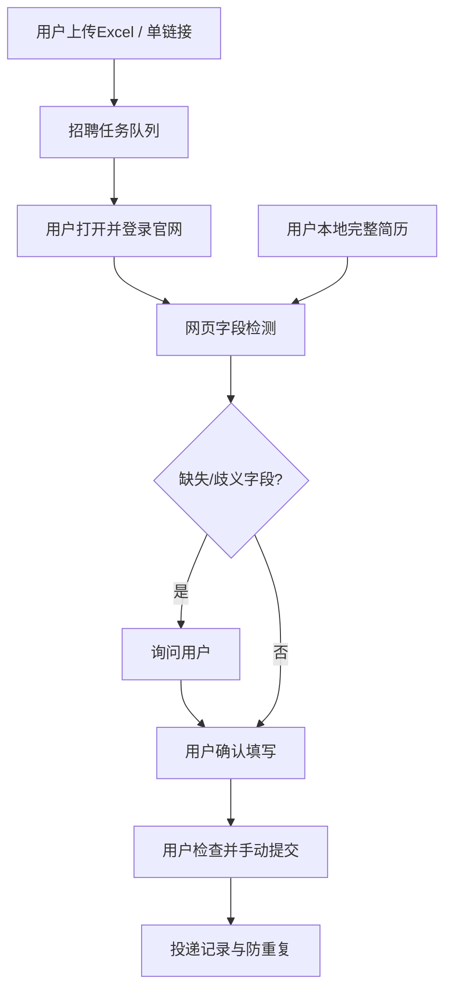

# JobFlow Assistant｜智能求职填表助手（作品集展示版）

> **Portfolio demo / not a production extension.** 这是从私人求职工具提炼的**公开展示仓库**，不包含用户数据、真实简历、登录凭据、付费授权系统或商业完整版的自动填表引擎。

## 解决什么问题？

多平台求职经常需要重复填写学校、实习、项目和联系方式。本项目探索：

1. 接收单个职位链接或 Excel 招聘链接清单；
2. 将用户主动输入的履历组织为结构化资料；
3. 在**用户明确授权后**，辅助匹配网页申请表字段；
4. 无法确定的字段先提问，不猜测；
5. 最终提交仍由用户本人操作；
6. 记录已经申请的岗位，减少重复投递。

## 当前状态

- **个人原型 V2.0：** 已有 Edge Manifest V3 扩展、Excel 队列、单链接入口、完整简历资料、缺项提问等功能；**不保证各招聘平台兼容**。
- **本仓库：** 展示数据结构、岗位去重规则和模拟流程，**不包含实际招聘网站自动填表的代码**。
- **发布状态：** 尚未发布到 Microsoft Edge Add-ons，未通过第三方审计；请勿作为成熟商业软件销售。

## 本地运行演示

下载本仓库，双击 `demo/index.html`：使用全虚构的求职示例数据，体验任务队列、状态变更、防重复提醒和缺失字段提问。演示不会访问招聘网站或发送数据。

## 代码示例和测试

需要 Node.js 18+（可选）：

```sh
node src/workflow.test.js
```

`src/workflow.sample.js` 演示岗位去重与安全状态更新（**不是**实际浏览器自动化主代码）。

## 架构示意



## 公开与商业产品的边界

- 本仓库为作品集演示，**不是全部源代码**；生产版建议放在 GitHub 私有仓库。
- 不能绕过登录、验证码或招聘网站访问控制；遵守相关网站服务条款。
- 简历包含个人信息。正式产品需具备透明的隐私说明、数据删除和导出机制、最小权限配置和安全测试。
- 不宣称“100% 成功投递”“自动获得面试”。
- 本仓库**尚未授予开源许可证**，保留所有权利。公开浏览不等于授权商业复制或再分发。若决定开源，请另行选择明确的 LICENSE。

## Roadmap / 规划

见 [公开发布验收清单](docs/release_checklist.md) 与 [架构说明](docs/architecture.md)。
